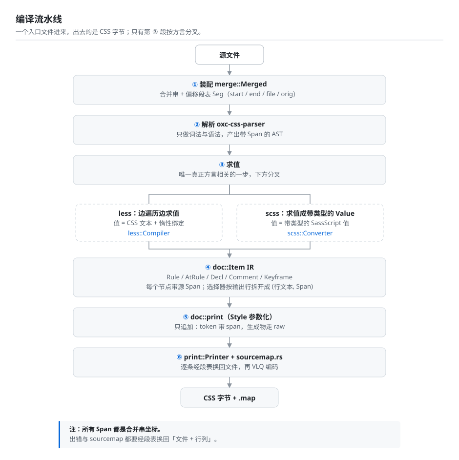

# Compilation pipeline

One style entry file goes in; CSS bytes come out (plus a `.map` when it is asked for). Six stages
sit in between: the pieces are assembled into one merged text, `oxc-css-parser` parses it into an
AST that carries positions, each dialect's evaluator produces the shared IR, and the printer writes
bytes in that dialect's output shape.

This page is for people changing the compiler internals: what each stage does, which symbol it
lives in, what is deliberately delegated to `oxc-css-parser` and what is this crate's own
semantics. For why the dialects do (or refuse to) share each piece, see
[architecture.md](architecture.md); the whole chain is drawn at the end of this page.

The entry point is `compile_file` in `src/lib.rs`: `.less` goes to the less channel; `.scss` /
`.sass` / `.css` / `.wxss` go to the scss channel (`.sass` is folded into equivalent SCSS text
during assembly). Each channel has its own assembly (①) and parse driver (②); what they share is
the segment table in `merge` and the `doc` / `print` / `sourcemap` layer.

## Stage boundaries

| Stage | What it does | Code |
| --- | --- | --- |
| ① Assembly | Resolves `@import` / `@use` / `@forward`, enumerates candidates, inlines text; folds the `.sass` indented syntax into equivalent SCSS. Every piece is concatenated into **one merged text**, and a segment table records which file and offset each output range came from | `scss/imports.rs`, `scss/indented.rs`, `less/imports.rs`, `merge.rs` |
| ② Parse | Lexing and parsing only; yields an AST whose nodes carry `Span` (byte ranges) | `scss/mod.rs`, `less/mod.rs` |
| ③ Evaluate | less: evaluate while walking the tree, emitting IR; scss: evaluate into typed `Value`s, then emit IR | `less/eval.rs`, `scss/eval.rs` |
| ④ IR | The output IR shared by both dialects: `Rule` / `AtRule` / `Decl` / `Comment` / `Keyframe`, each node carrying a source span | `doc.rs` |
| ⑤ Print | Writes bytes according to `Style` and records source map entries; every shape difference between the dialects is confined to `Style` | `doc.rs`, `print.rs` |
| ⑥ Source map | Turns the recorded `(output offset, source span)` pairs back into a file and line/column, then VLQ-encodes them | `sourcemap.rs`, `merge.rs`, `lib.rs` |

The walkthrough below follows `a.scss`; less is isomorphic, with the differences called out.

## 1. Assembly (`scss::imports::Loader`)

Nothing here touches the AST yet; it is all text and path work:

- `@import`: finds the file through dart's candidate enumeration (`_partial` prefix, directory index, `.scss/.sass/.css` suffixes) and inlines it recursively;
- `@use` / `@forward`: each module is loaded once, its contents are placed **before** the dependent, and a `ModuleInfo { file, scope }` is registered; modules do not share scope, they are kept apart by scope number;
- the `.sass` indented syntax is folded into equivalent SCSS here (`scss/indented.rs`);
- all pieces are concatenated into one **merged text**, `Merged.text`, and each piece records a `Seg { start, end, file, orig }`.

**Code**: `compile` in `src/scss/mod.rs` calls `Loader::new(...).run()` (the `Loader` in
`src/scss/imports.rs`, which returns `Loaded { merged, deps, modules, scopes, scope_of }`); the
indented syntax goes through `indented::to_scss`; the merged text and the segment table are
`Merged` / `Seg` in `src/merge.rs`, and pieces are appended by `Merged::append_part`. On the less
side, `compile` in `src/less/mod.rs` calls `less::imports::expand_imports`.

Why one merged text rather than one AST per file: `@import` is textual relocation by definition
(shared scope, nested position preserved), so after the splice every later stage needs only one
coordinate system; on error the segment table maps a merged-text offset back to "which file,
which line".

## 2. Parse (oxc-css-parser)

```rust
let alloc = Allocator::default();
let mut parser = ParserBuilder::new(&alloc, merged.text.as_str())
    .syntax(Syntax::Scss)      // less channel: Syntax::Less
    .comments()                // also keep block comments: position and content
    .build();
let ast = parser.parse::<Stylesheet>()?;   // oxc AST, nodes carry oxc_css_parser::pos::Span
```

oxc does exactly two things here — **lexing and parsing** — and hands back an AST whose nodes
carry `Span` (byte ranges). We do not use its visitor, we do not use its printer, and we never
serialize its AST directly. Both dialects' `Syntax` values are supported by it (`Syntax::Less` /
`Syntax::Scss`), so the two channels share one parser version and an upgrade touches a single
dependency.

Parse errors surface in merged-text coordinates, so reporting one has to go through the segment
table first: `merged.locate_exact(span.start)` yields the file plus an offset into that file, and
`position_in(file, local)` turns that into file and line/column.

**Code**: `compile` in `src/scss/mod.rs` (`.syntax(Syntax::Scss)`) and `compile` in
`src/less/mod.rs` (`.syntax(Syntax::Less)`). The error mapping lives in `Merged::locate_exact` and
`Merged::position_in` in `src/merge.rs`; the less channel calls both explicitly inside `compile`,
while the scss channel wraps them in `Merged::error_at`.

## 3. Evaluate (the last place the dialects part)

The two channels fork here — **this is the only genuinely dialect-specific place in the whole
chain**:

- **scss** (`scss::Converter` walks `ast.statements`):
  - `decls.rs`: variable declarations, nested properties, custom properties;
  - `flow.rs`: `@mixin`/`@include`/`@content`/`@if`/`@each`/`@for`/`@while`; the frame stack and scopes live here;
  - `eval.rs` + `value.rs` + `builtins.rs` + `modules.rs`: typed SassScript values (numbers with compound units, colors kept as f64 and rounded only at serialization, lists/maps/strings), built-in functions and the built-in module member table;
  - `selector.rs`: nested selector expansion (`&` resolution, `@at-root`) and `@extend` selector merging;
  - `prelude.rs`: nested merging and variable substitution for `@media`/`@supports`;
  - `module_use.rs`: namespace member resolution, `@forward` lazy forwarding edges, `@use … with` configuration.
- **less** (`less::Compiler` walks the statements, evaluating as it goes):
  - `env.rs` keeps frames/scopes and lazy bindings; `eval.rs` handles mixin expansion, guards, `@each`, variable evaluation;
  - `value.rs` implements the "CSS text + lazy bindings" model, with arithmetic in less's 8-digit precision;
  - `guard.rs`, `file_fn.rs` (`data-uri`/`svg-gradient` and friends), `extend.rs` (`&:extend()`).

Both evaluators output `Vec<doc::Item>` — **not a string**. Early less evaluated and wrote into a
buffer as it went, which left `@extend` no option but to go back and patch text that had already
been emitted; now both sides build the IR first, `@extend` edits selectors inside the IR, and the
printer needs no "rewrite bytes already written" interface.

**Code**: `Converter` in `src/scss/mod.rs`; `Compiler` in `src/less/mod.rs`. The `decls.rs` /
`flow.rs` / `value.rs` … listed above all live under `src/scss/` and `src/less/`.

## 4. IR (`doc.rs`)

```text
Item   = Rule | Keyframe | AtRule | Comment | Raw
Body   = Rules(Vec<Item>) | Decls(Vec<DeclItem>)
DeclItem = Decl | Comment | AtRule(no block)
```

Every node carries its source `Span`; `Rule.selector` is `SelectorLines` — a list of `(line text,
Span)` pairs **split by output line**. The only reason to split is the source map: dart maps every
line of a multi-line selector list to the start of the list, so without splitting you can only emit
a mapping for the first line (fixing this is what brought bootstrap5's 252 missing mappings down to
zero).

`Item::Raw` is the escape hatch, taken only by the four things that are "arbitrary CSS text" to
begin with: the contents of an `@import (inline)` file, a less sub-compilation's output, the body of
`e("…")`, and the compact declaration body of `(reference)`.

**Code**: `Item` / `Body` / `DeclItem` / `Rule` / `Raw` in `src/doc.rs`; `SelectorLines` is a type
alias for `Vec<(String, Span)>` and `selector_lines` in the same file does the splitting. `Style`
is defined at the top of `src/doc.rs` (the constants `Style::SASS` and `Style::LESS`).

## 5. Print (`doc::print` drives `print::Printer`)

```rust
let (css, map) = print(&items, &Style::SASS, entry, &merged, opts);
```

The printer is **append-only**: every token that comes from source goes through
`Printer::token(text, span)` (recording a `Pending { offset, file, span }`), while indentation,
newlines and commas are generated through `Printer::raw`. Whether a position can be traced back is
decided by whether a span was passed at print time, so nothing has to be filled in afterwards, and
"bytes were rewritten but the mapping was not" cannot happen.

`Style` is the only place where the two channels are allowed to differ at the output layer (6
fields: `blank_line_after_rule` / `indent_selector_continuation` / `charset` / `trailing_newline` /
`sources_content` / `verbatim_comments`; see architecture.md for the values).

**Code**: `print` plus `emit_item` / `emit_items` / `emit_selector` in `src/doc.rs`; `Printer` in
`src/print.rs` (`token` / `token_in` / `raw` / `newline` / `indent` / `finish`) and the private
`Pending`.

## 6. Source map (`sourcemap.rs`)

Once printing is done, `Printer` holds a list of `(output byte offset, source file, source Span)`.
Each entry is mapped back to a file and an original offset through `merge`'s segment table, then
converted to line/column with that file's `LineIndex` (columns are UTF-16), and finally VLQ-encoded
into `mappings`. Whether `sourcesContent` is emitted is decided by `Style::sources_content` (less:
not for a single source, yes for several; dart: always).

**Code**: `Printer::finish` in `src/print.rs` (`locate` consults the segment table); `vlq` /
`encode_mappings` / `to_json` in `src/sourcemap.rs`; `LineIndex::line_col` in `src/lib.rs` (UTF-16
columns).

## Where oxc stops (deliberately)

| Used | Not used (and why) |
| --- | --- |
| `ParserBuilder` + `Syntax::{Less,Scss}` | Its printer: the output has to match lessc / dart-sass byte for byte, so indentation, blank lines, `@charset` and selector continuation are ours to control |
| `Span` (byte ranges, on every node) | Its visitor: evaluation has to control the frame stack, module scope and `@extend` ordering — traversal order is part of our semantics |
| `parser.comments()` (content and position of block comments) | The AST as IR: the AST is "syntactic shape", the IR is "output shape", and evaluation sits in between |

The short version: **oxc turns text into a positioned syntax tree; everything else — assembly,
evaluation, output shape, source maps — is this crate's semantics**.

## Current size

The shared layer is small and stable; almost all of the volume is the two dialect evaluators:

| Part | Lines |
| --- | --- |
| `src/lib.rs` (dispatch, `Options` / `Output`, `LineIndex`) | 104 |
| `src/merge.rs` (merged text `Merged` + segment table `Seg`) | 331 |
| `src/doc.rs` (IR, `Style`, printing) | 841 |
| `src/print.rs` (append-only byte writer) | 253 |
| `src/sourcemap.rs` (VLQ / `sourcesContent`) | 168 |
| `src/less/*` (less front end) | 9981 |
| `src/scss/*` (scss front end) | 18261 |

Add `src/error.rs` (44 lines) and `src/text.rs` (176 lines) and `src/` totals 30159 lines (not
counting the CLI under `src/bin`).

Only four product symbols are public: `compile_file` / `Options` / `Output` / `CompileError`
(`LessOptions` is the type of the `Options::less` field; `LineIndex` and the `scss` module are
`#[doc(hidden)]` test hooks). In other words, all six stages above are internal: any of them can be
replaced without touching callers.

## Diagram

The trunk is what both dialects share; only stage ③ forks and merges again:


